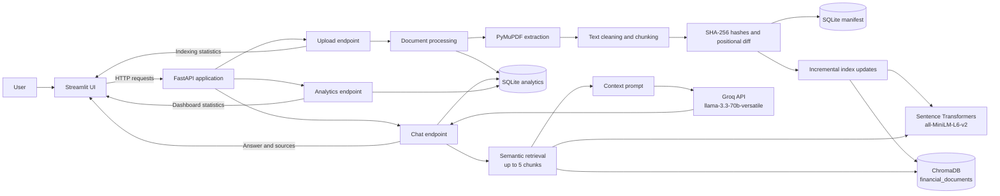

# Financial Incremental RAG

A local financial-document question-answering application that combines a FastAPI backend, a Streamlit interface, persistent ChromaDB vector search, and Groq-hosted language generation. Its indexing pipeline compares SHA-256 hashes for chunks at the same position in a document and embeds only chunks classified as new or changed.

## Overview

**Problem statement:** Financial reports are long, and re-embedding an entire report whenever it is uploaded again can waste time and embedding work. This project extracts text from PDF reports, splits it into page-associated chunks, and records chunk hashes in a SQLite manifest. On a subsequent upload with the same filename, it compares the new chunk hashes with the stored manifest and adds, updates, or removes corresponding ChromaDB entries.

The application then retrieves up to five semantically similar chunks for a question and sends their text as context to Groq for an answer. Retrieved evidence and basic upload/query metrics are available in the Streamlit interface and analytics API.

### Objectives

- Answer questions using text retrieved from uploaded financial PDFs.
- Reuse unchanged indexed chunks on repeat uploads instead of embedding them again.
- Retain source-document and page metadata with each vector for evidence display.
- Track document, incremental indexing, and query performance metrics.

### Implemented features

- PDF upload through the Streamlit interface and the API.
- Page-by-page PDF text extraction, text cleanup, and recursive chunking.
- Position-based chunk change detection using normalized SHA-256 hashes.
- Persistent vector storage and semantic retrieval with ChromaDB and Sentence Transformers.
- Context-grounded answer generation through the Groq API.
- Source document, page, distance, and retrieved text in chat responses.
- Streamlit upload, chat, and analytics views.
- SQLite persistence for the document/chunk manifest and analytics metrics.

## Architecture



### Component responsibilities

| Component | Responsibility |
|---|---|
| Streamlit (`frontend/streamlit_app.py`) | Presents upload, financial chat, and analytics screens; calls the API at `http://127.0.0.1:8000`. |
| FastAPI (`app/main.py`, `app/api/`) | Starts the application and databases, exposes health and application endpoints, and connects requests to services. |
| Document processing services (`app/services/`, `app/utils/`) | Extract and clean PDF text, split it into chunks, compare hashes, update the vector index and manifest, and record upload metrics. |
| Retrieval and RAG services | Embed questions, query ChromaDB, build a context prompt, call Groq, and record successful answer-generation metrics. |
| SQLite databases | Store document/chunk indexing state and aggregate upload/query metrics. |
| ChromaDB | Persist chunk text, embeddings, and document/page/chunk metadata for similarity search. |
| Groq API | Generate an answer from the retrieved context using the configured chat model. |

## Technology stack

| Technology | Use |
|---|---|
| Python | Application language; the code uses Python 3.10+ type syntax. |
| FastAPI, Pydantic, Uvicorn | HTTP API, request validation, and ASGI server. |
| Streamlit | Browser-based user interface. |
| Requests | Calls from the Streamlit UI to the backend. |
| PyMuPDF (`pymupdf`) | Page-by-page PDF text extraction. |
| LangChain text splitters | Recursive character splitting with overlap. |
| Sentence Transformers (`all-MiniLM-L6-v2`) | Local embeddings for document chunks and user questions. |
| ChromaDB | Persistent vector collection and similarity search. |
| Groq Python SDK | Calls `llama-3.3-70b-versatile` to generate contextual answers. |
| SQLite (`sqlite3`) | Document manifest and analytics persistence. |
| pandas, Plotly | Analytics data preparation and charts in the UI. |
| python-dotenv | Loads `GROQ_API_KEY` from a local `.env` file. |

`requirements.txt` also declares `langchain-community`, `python-docx`, SQLAlchemy, `tqdm`, and NumPy. They are not directly imported by the current application source; in particular, the presence of `python-docx` does not mean DOCX processing is implemented. SQLite is accessed through Python's standard-library `sqlite3`, not SQLAlchemy.

## Project structure

```text
.
├── README.md
├── requirements.txt
├── .gitignore
├── app/
│   ├── main.py
│   ├── api/
│   │   ├── analytics.py
│   │   ├── chat.py
│   │   ├── routes.py
│   │   └── upload.py
│   ├── core/
│   │   ├── config.py
│   │   └── logger.py
│   ├── database/
│   │   ├── analytics_db.py
│   │   ├── chroma_db.py
│   │   └── sqlite_db.py
│   ├── models/
│   │   └── schemas.py
│   ├── services/
│   │   ├── analytics_service.py
│   │   ├── diff_service.py
│   │   ├── document_service.py
│   │   ├── embedding_service.py
│   │   ├── groq_service.py
│   │   ├── hashing_service.py
│   │   ├── incremental_service.py
│   │   ├── index_service.py
│   │   ├── manifest_service.py
│   │   ├── prompt_builder.py
│   │   ├── rag_service.py
│   │   └── retrieval_service.py
│   └── utils/
│       ├── cleaner.py
│       ├── pdf_loader.py
│       └── splitter.py
├── frontend/
│   └── streamlit_app.py
├── documents/
│   └── RIL-IAR-2025.pdf
├── manifest_db/
│   └── manifest.db
├── analytics_db/
│   └── analytics.db
└── chroma_storage/
    ├── chroma.sqlite3
    └── <collection-id>/
        ├── data_level0.bin
        ├── header.bin
        ├── index_metadata.pickle
        ├── length.bin
        └── link_lists.bin
```

The database and Chroma files shown above are persisted local data, not source modules. `app/api/routes.py`, `app/core/config.py`, and `app/core/logger.py` are currently empty; routes are registered directly in `app/main.py`. `IndexService` is present, but the active upload pipeline uses `IncrementalService`.

## End-to-end workflow

### Upload and incremental indexing

1. The user selects a PDF and submits it in Streamlit, or sends it as multipart form data to `POST /upload`.
2. The upload handler saves the file under `documents/` using its filename.
3. `PDFLoader` extracts text page by page. `TextCleaner` normalizes whitespace, then `FinancialTextSplitter` creates chunks of up to 1,000 characters with 200 characters of overlap. Each chunk retains its page number.
4. `HashingService` collapses whitespace and calculates a SHA-256 hash for each chunk. `DiffService` compares hashes at matching zero-based chunk indexes against the manifest for that filename.
5. `IncrementalService` embeds and adds new chunks, re-embeds and updates modified chunks, deletes removed chunks, and leaves unchanged chunks alone. Embeddings use the local `all-MiniLM-L6-v2` model.
6. The chunk hashes and document metadata are recorded in `manifest_db/manifest.db`. Upload statistics are appended to `analytics_db/analytics.db` and returned to the caller.

Chunk reuse is based on the same filename and chunk position, not global content deduplication. Uploading the same report under a different filename creates a separate document identity.

### Question answering

1. Streamlit posts the question to `POST /chat/`.
2. `RetrievalService` embeds the question and asks the ChromaDB collection for up to five nearest chunks.
3. `RAGService` places the retrieved chunk text, document names, and page numbers into a context prompt. If no chunks are available, it returns a no-relevant-information answer without calling Groq.
4. `GroqService` sends the prompt to `llama-3.3-70b-versatile`, with instructions to answer only from the provided context.
5. The API returns the answer and source chunks. For generated answers, the first retrieved document and page and the response time are recorded in query analytics.

### Analytics

The analytics API reads aggregate statistics from the upload and query metrics tables. The dashboard displays report/company/chunk/query totals, counts of new/modified/deleted/reused chunks, embedding-call counts, average processing time, and average response time.

## API documentation

The API runs at `http://127.0.0.1:8000` with FastAPI's interactive documentation at `/docs` and `/redoc`.

| Method and path | Request | Successful response |
|---|---|---|
| `GET /` | None | `{"message":"Financial Document Intelligence System API is running."}` |
| `GET /health` | None | `{"status":"healthy","backend":"FastAPI","database":"SQLite","vector_db":"ChromaDB"}` |
| `POST /upload` | Required multipart form field `file`; PDF is the supported format. | Filename, page/chunk counts, incremental counts, embedding counts, reuse percentage, processing time, status, and message. |
| `POST /chat/` | JSON body `{"question":"..."}` | `answer` string and `sources` array. |
| `GET /analytics` | None | Aggregate `documents`, `incremental`, and `queries` objects. |

### Upload a PDF

```bash
curl -X POST http://127.0.0.1:8000/upload \
  -F "file=@RIL-IAR-2025.pdf"
```

Example response shape:

```json
{
  "filename": "RIL-IAR-2025.pdf",
  "pages": 120,
  "chunks": 540,
  "new_chunks": 540,
  "modified_chunks": 0,
  "deleted_chunks": 0,
  "unchanged_chunks": 0,
  "embedding_calls": 540,
  "embedding_calls_saved": 0,
  "reused_chunks_percentage": 0.0,
  "processing_time_seconds": 12.34,
  "status": "Incremental Indexing Completed",
  "message": "Incremental indexing completed."
}
```

The counts and timings above are illustrative. A repeat upload with no detected changes returns the same fields with zero new, modified, and deleted chunks.

### Ask a question

```bash
curl -X POST http://127.0.0.1:8000/chat/ \
  -H "Content-Type: application/json" \
  -d "{\"question\":\"What was the reported revenue?\"}"
```

Example response shape:

```json
{
  "answer": "<answer generated from the retrieved context>",
  "sources": [
    {
      "chunk_id": "RIL-IAR-2025.pdf_1",
      "document": "RIL-IAR-2025.pdf",
      "page": 1,
      "distance": 0.42,
      "text": "<retrieved chunk text>"
    }
  ]
}
```

When the vector collection is empty or no results are returned, the successful response is `{"answer":"No relevant information found.","sources":[]}`.

### Read analytics

```bash
curl http://127.0.0.1:8000/analytics
```

Response shape:

```json
{
  "documents": {
    "reports": 0,
    "companies": 0,
    "chunks": 0,
    "sectors": 0
  },
  "incremental": {
    "new_chunks": 0,
    "modified_chunks": 0,
    "deleted_chunks": 0,
    "unchanged_chunks": 0,
    "embedding_calls": 0,
    "embedding_calls_saved": 0,
    "average_processing_time": 0.0
  },
  "queries": {
    "total_queries": 0,
    "average_response_time": 0.0
  }
}
```

### Errors and validation

- FastAPI/Pydantic returns `422 Unprocessable Entity` for invalid request bodies or a missing required upload field.
- The chat handler converts exceptions raised during retrieval or generation to `500 Internal Server Error` with the exception text in `detail`.
- Upload and analytics errors are not translated into custom error responses; unhandled failures use FastAPI's server-error behavior.
- The upload endpoint does not implement a file-size limit or explicit file-type validation. The processing pipeline itself uses a PDF loader, so non-PDF uploads are not supported.

## Database and vector schema

### Manifest database: `manifest_db/manifest.db`

Created by `app/database/sqlite_db.py`.

| Table | Columns and purpose |
|---|---|
| `documents` | `id` primary key, unique `filename`, `page_count`, `chunk_count`, `upload_date`, and `status`. Stores the latest document-level indexing metadata. |
| `manifest` | `id` primary key; `document_name`, `document_id`, unique `chunk_id`, `chunk_index`, `page`, `chunk_hash`, `embedding_id`, `version`, `created_at`, and `updated_at`. Tracks the current hash and vector identity for each chunk. |

The manifest table has no declared foreign key to `documents`. Document identity is based on the filename; vector IDs are formed from the filename and one-based chunk number. The `chunk_index` used for comparison starts at zero.

### Analytics database: `analytics_db/analytics.db`

Created by `app/database/analytics_db.py`.

| Table | Stored data |
|---|---|
| `upload_metrics` | Filename, derived company label, sector label, pages/chunks, new/modified/deleted/unchanged counts, embedding calls and estimated saved calls, reuse percentage, processing time, and upload timestamp. The current pipeline derives company from the filename prefix before `-` and records sector as `Unknown`. |
| `query_metrics` | Question, response time, first retrieved document and page, and query timestamp. |

These are append-only metric records with no declared relationship to manifest rows. Queries that return no chunks do not reach the query-metric insertion step.

### Vector collection

ChromaDB uses a persistent client at `chroma_storage/` and the collection `financial_documents`. Each vector stores its chunk text and embedding, with `document_name`, `page`, and `chunk_number` metadata. The collection is queried without a document filter and returns the nearest results across indexed documents.

## Installation and setup

### Prerequisites

- Python 3.10 or newer.
- A Groq API key for answer generation.
- Internet access for installing dependencies, downloading the Sentence Transformers model on first use, and calling Groq.

The repository does not pin dependency versions or include a lockfile.

### Create an environment and install dependencies (Windows PowerShell)

Run these commands from the repository root:

```powershell
py -3 -m venv .venv
.\.venv\Scripts\python.exe -m pip install --upgrade pip
.\.venv\Scripts\python.exe -m pip install -r requirements.txt
```

Create a `.env` file in the repository root containing your own key:

```dotenv
GROQ_API_KEY=your_groq_api_key
```

`GROQ_API_KEY` is the environment variable read by the application. It must be set before the backend imports its chat services; the backend fails during startup if it is missing. Do not commit `.env` or paste a real key into documentation or source control. Database locations, model names, and the frontend backend URL are constants in the source rather than environment-configurable settings.

## Run locally

Start the backend from the repository root:

```powershell
.\.venv\Scripts\python.exe -m uvicorn app.main:app --reload
```

In a second PowerShell terminal, from the same root, start the UI:

```powershell
.\.venv\Scripts\python.exe -m streamlit run frontend\streamlit_app.py
```

Open the Streamlit URL printed by the command (normally `http://localhost:8501`). The UI expects the API at `http://127.0.0.1:8000`; if you change the API host or port, update `BACKEND_URL` in `frontend/streamlit_app.py`. FastAPI's interactive docs are available at `http://127.0.0.1:8000/docs`.

The backend initializes the SQLite databases and Chroma collection on startup. Upload a PDF before asking document-specific questions. The first use of the embedding model may take longer while the model is downloaded and loaded.

## Screenshots and demo data

No screenshots or video demo are checked into the repository. A sample PDF is available at [`documents/RIL-IAR-2025.pdf`](documents/RIL-IAR-2025.pdf) and can be uploaded using the UI or API. The checked-in SQLite and Chroma files contain local persisted application data.

## Limitations and potential future work

### Current limitations

- PDF is the only supported document format; there is no OCR path for image-only/scanned PDFs.
- Chunk comparisons are positional within a filename. Insertions or deletions can shift later chunks and cause additional updates; identical content under different filenames is not deduplicated.
- Retrieval is limited to five nearest chunks and searches the shared collection without per-document filters.
- A Groq API key and network access are required for answer generation; there is no local LLM fallback.
- There is no authentication or authorization, and the API enables permissive CORS for development.
- Upload limits and explicit file-type checks are not implemented in the API.
- Paths and model/API URL settings are hard-coded, requirements are unpinned, and no automated test suite is included in the repository.

### Potential future improvements (not implemented)

- Add document-format validation, upload-size limits, and support for additional formats or OCR.
- Make database paths, model names, backend URL, and CORS origins configurable.
- Add authentication, document-scoped retrieval, and deployment-oriented security settings.
- Add automated tests, dependency lock/version policy, and evaluation of retrieval and answer quality.
- Improve chunk matching so edits earlier in a document do not make position-shifted chunks appear changed.
